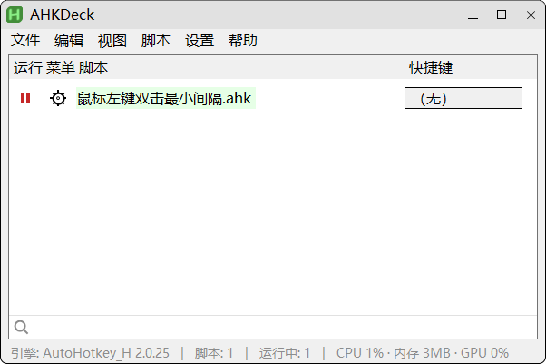

# AHKDeck

**[⬇️ 下载 0.3.3 (Gitee)](https://gitee.com/qiuzongman/AHKDeck/releases/download/0.3.3/AHKDeck_0.3.3.zip)**
｜ **[⬇️ 下载 0.3.3 (GitHub)](https://github.com/zongmanqiu/AHKDeck/releases/download/0.3.3/AHKDeck_0.3.3.zip)**


> AHKDeck: [Gitee](https://gitee.com/qiuzongman/AHKDeck)
 ｜ [GitHub](https://github.com/zongmanqiu/AHKDeck)

> 脚本仓库: [Gitee](https://gitee.com/qiuzongman/ahk-v2-scripts)
 ｜ [GitHub](https://github.com/zongmanqiu/ahk-v2-scripts)

## 特点
- 每个脚本会话跑在独立子进程里，互不干扰；真正退出宿主时由 Job Object 一并回收。
- 标题栏关闭通常只是隐藏到托盘，脚本继续运行。
- 支持mcp，可接入AI进行脚本撰写与修改。
- 合并托盘菜单：脚本自己的图标收起，各脚本菜单汇集到宿主「运行中」子菜单。
- 一键把脚本编译成独立 exe（直接复制随包的同一个内核，机器上不用装 AutoHotkey）。

## 窗口



## 使用

- 将脚本放入程序旁的 `Scripts/`，在列表中运行、停止、重启或编辑。
- 「脚本 > 获取脚本…」从官方脚本仓库下载或升级脚本，安装到程序旁的 `Scripts/`；
  打开时读随包清单，只有点「刷新」才联网。右边的「订阅」打开订阅管理：填一份同格式的
  `scripts.json` 地址并点「订阅」，它就进到订阅表里（可增可删），这些清单同时合并进同一个列表，
  每行左侧的「来源」列标明它来自「官方」还是某个订阅（重名脚本保留先出现的那个，官方优先）。
  订阅名取清单里自报的 `name`，清单没写就显示域名。两个窗口都可缩放、可最大化。
  清单顶层可以就是脚本数组（官方仓库的形状），也可以是 `{"name": "某某脚本集", "scripts": [ … ]}`，
  后者能让订阅显示自己起的名字。
- 内置编辑器提供保存、查找替换；当前编辑脚本的运行回执与内核错误显示在控制台，各会话日志写入程序旁
  的 `temp/logs/`。
- 「脚本 > 编译为 EXE」（或行右键同名项）先弹「另存为」选位置和名称，产物是独立 exe，可在任何 Windows
  机器直接双击运行（免装 AutoHotkey）；它直接复制随包的 `AutoHotkey64.exe` 并写入脚本资源，
  不再需要 Ahk2Exe 或 `tools/`。覆盖同名旧产物时自动备份为 `.old`；对话框与任务结束后自动把工作集
  交还系统；不做 UPX 之类的运行时加壳（轻量口径：省的是磁盘、花的是运行内存）。
- AI 接入使用 MCP stdio：外部客户端负责模型和修正循环，本程序提供脚本工具与可见编辑区，不内建聊天面板。
- 行右键「删除…」（或「脚本 > 删除…」）把选中脚本移到程序旁的 `temp/deleted/`，不是永久删除；
  运行中的脚本会先停止，该脚本的快捷键一并释放。
- 程序旁只有一个 `temp/` 存放运行期产物：`logs/`（会话日志）、`backups/`（写前副本与升级回滚）、
  `work/`（编译与试跑中间物）、`deleted/`（删除的脚本）。「设置 > 选项…」选保留时长
  （永不 / 7 / 30 / 180 天，默认 30），每次启动清理一次，改完立即清理一次。
- 「设置 > 选项…」里的「官方下载源」（Gitee / GitHub）是**一个**设置，同时决定：脚本清单从哪个镜像取、
  官方脚本从哪个镜像下载、宿主更新清单从哪个镜像取、更新包从哪个平台取。更新与脚本窗口只显示、不修改。
- 仅运行可信脚本。工具路径校验不等于脚本执行沙箱；与官方 AHK 的一致性由具体对拍用例验证，不作完全兼容保证。

在解压后的程序目录运行：

```bat
AHKDeck.exe
AHKDeck.exe --version
AHKDeck.exe --run Scripts\鼠标左键双击最小间隔.ahk
AHKDeck.exe --journal --run Scripts\鼠标左键双击最小间隔.ahk
AHKDeck.exe --mcp-stdio
AHKDeck.exe --quit 目标实例PID
```

`--journal` 输出逐行 JSON 事件；`--run` 每次运行一个脚本，可在脚本路径后传参。
`--quit` 可指定实例 PID，不指定则通知所有工作台退出。MCP 接入细节见 [agent/README.md](agent/README.md)。

## 构建

需要 Windows x64、MSVC C++ 工具链与 Windows SDK、CMake（至少 3.16）、NMake、MSBuild，以及下载工具 curl/tar。
MCP 门禁另外需要 Python；未找到 Python 时 CMake 不注册这些测试。

当前构建脚本要求源码位于工作区的 `.main/` 子目录；`.3rd/`、`.temp/`、`.build/` 与其同级，分别存放依赖、构建中间物和成品。它们是相对目录约定，不绑定本机位置。

从该工作区执行：

```bat
.main\build\full.bat
```

流程：工具链检查 → 下载依赖 → 应用补丁 → 构建 → 测试，失败即停。
日常增量构建用 `.main\build\4_build.bat`，验证用 `.main\build\5_test.bat`。
产品包含 `AHKDeck.exe` 与唯一内核 `AutoHotkey64.exe`（官方 AutoHotkey v2.0.31 ＋ m192 补丁），
不是单文件分发；这一个 EXE 既被宿主按会话启动，也是「脚本/编译为 EXE」复制的底座（m192 P4 起
不再有 `AutoHotkey64.dll` 或 `tools\`）。脚本同步到 `.build/Scripts/`。
发行包由 [6_package.ps1](build/6_package.ps1) 用 7z 生成，白名单见 [打包清单](build/打包清单.md)。
依赖版本以 [build/deps.txt](build/deps.txt) 为准，详细步骤见 [构建说明](build/build_readme.md)。

## 文档导航

| 文档 | 职责 |
|---|---|
| [目录结构说明](目录结构说明.md) | 文件放哪里、模块职责与依赖 |
| [开发指南](开发指南.md) | 修改流程、线程边界与验证 |
| [文档清单](DOCS_MANIFEST.md) | 改动后应同步哪些文档 |
| [更新历史](HISTORY.md) | 各版本的新增、修复与门禁记录 |
| [UI 说明](ui/README.md) | 当前交互与共享控件职责 |
| [引擎说明](engine/README.md) | 会话、错误记录与生命周期 |

许可见 [LICENSE](LICENSE)；第三方组件与分发说明见 [THIRD-PARTY-NOTICES.md](THIRD-PARTY-NOTICES.md)。
